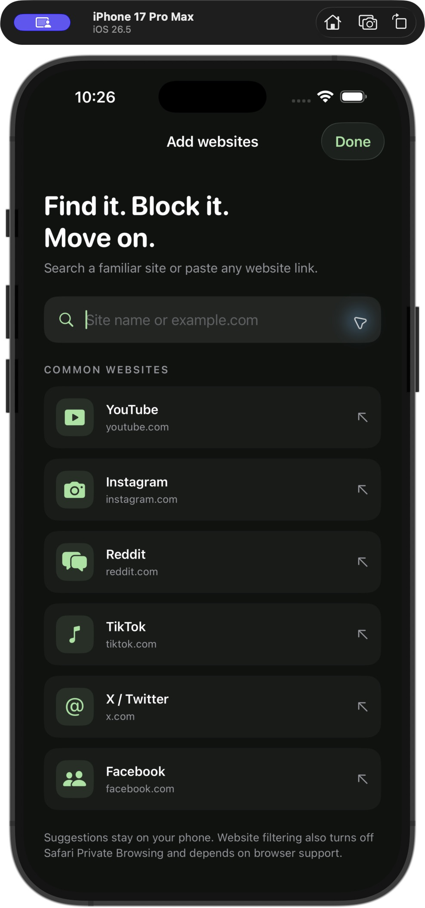
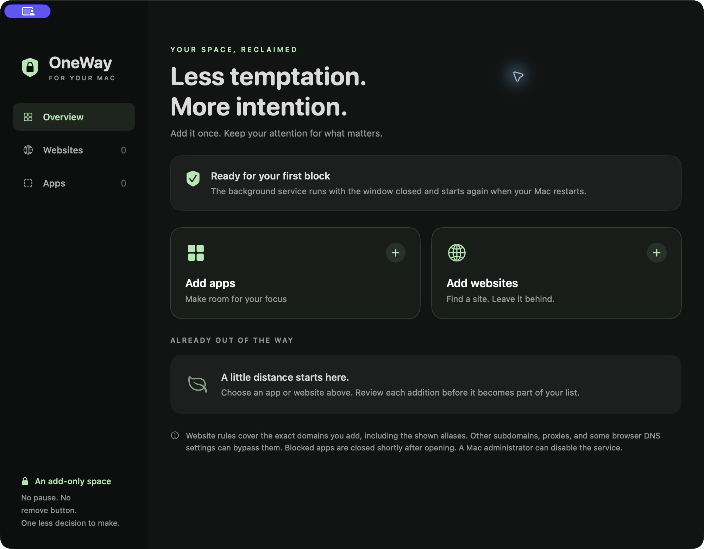

<p align="center">
  
</p>

<h1 align="center">OneWay</h1>
<p align="center"><strong>Less temptation. More intention.</strong><br>Native, add-only app and website blockers for iPhone and Mac.</p>

<p align="center">
  <a href="https://github.com/FarzamHejaziK/OneWay/actions/workflows/ci.yml"></a>
  <a href="LICENSE"></a>
  
  
  
</p>

<p align="center"><a href="#get-started">Get started</a> · <a href="docs/architecture.md">Architecture</a> · <a href="docs/troubleshooting.md">Troubleshooting</a> · <a href="CONTRIBUTING.md">Contributing</a></p>

OneWay helps you put distracting apps and websites out of reach. Choose what to block, review your choice, and add it to your list. There is no pause button, countdown, or remove control to negotiate with later.

Both apps run locally. There is no account, hosted backend, subscription, analytics, or cloud sync. You build and install them directly with your own Apple signing setup; no TestFlight or App Store publication is required.

> **An add-only commitment tool, not a tamper-proof lock.** iPhone Screen Time authorization can be revoked. A Mac administrator can disable the service. Website enforcement differs between platforms and browsers. Read the [limitations](#know-the-limits) before relying on it.

## A familiar experience on both devices

<table>
  <tr>
    <td align="center" width="30%"><strong>iPhone · website search</strong></td>
    <td align="center" width="70%"><strong>Mac · your focus space</strong></td>
  </tr>
  <tr>
    <td align="center"></td>
    <td align="center"></td>
  </tr>
</table>

The iPhone image is a Simulator UI preview; it does not demonstrate Screen Time enforcement. The Mac image shows the empty-list state before adding personal blocks.

## What you get

- **Add-only lists.** New selections are merged with existing blocks. Deselecting a previous choice never removes a saved block.
- **Thoughtful website entry.** Local autocomplete, pasted-link normalization, explicit aliases, and a review step before saving.
- **Native app selection.** Apple's Screen Time picker on iPhone; installed app search and browsing on Mac.
- **Local persistence.** Save first, apply second. Corrupt data stops edits instead of silently resetting the list.
- **Background enforcement.** iOS manages its restrictions; the Mac uses an approved system service that outlives the app window.
- **Readable source.** Swift and SwiftUI, without third-party runtime dependencies.

| | iPhone | Mac |
| --- | --- | --- |
| Minimum deployment target | iOS 17 | macOS 14, Apple Silicon |
| App enforcement | Family Controls + Managed Settings shields | Background watcher closes selected user apps |
| Website enforcement | Managed Settings website filtering | Exact-hostname IPv4/IPv6 hosts rules |
| Categories | Native Screen Time categories | Individual apps only |
| Permission | Individual Screen Time authorization | Administrator approval for a background daemon |
| Data | App-local Application Support | Root-owned Application Support |
| Sync | Separate local list | Separate local list |

## Get started

This is an early, source-first project. There are no prebuilt, notarized downloads or App Store releases. Start by cloning the entire repository: the Mac app reuses the iPhone domain parser, website catalog, and icon.

```sh
git clone https://github.com/FarzamHejaziK/OneWay.git
cd OneWay
```

### iPhone

1. Install Xcode with iOS platform support and sign in with an Apple Developer account that can provision Family Controls.
2. Copy `OneWay/Signing.example.xcconfig` to `OneWay/Signing.local.xcconfig`. Set your team ID and a unique bundle identifier. The local file is ignored by Git.
3. Open `OneWay/OneWay.xcodeproj`, select your connected iPhone, and enable automatic signing with the Family Controls capability.
4. Trust the Mac, enable Developer Mode on the iPhone, and run the app from Xcode.
5. Grant Screen Time access in OneWay. Carefully review each permanent addition.

Use a paid Apple Developer membership for the documented setup; do not assume a free Personal Team can provision this capability. Direct development installation and public distribution have different signing/entitlement requirements.

See the [iPhone guide](OneWay/README.md) for installation, limits, and physical-device checks.

### Mac

1. Use an Apple Silicon Mac with Xcode command line tools and a Developer ID Application certificate in your keychain.
2. Copy `OneWayMac/.signing.example.json` to `OneWayMac/.signing.json` and fill in your team ID, signing identity, and unique bundle identifier.
3. Build and install:

   ```sh
   ./OneWayMac/install.sh
   ```

4. Open OneWay, choose **Set up**, and approve its background service in **System Settings → General → Login Items & Extensions** if requested.
5. Add an app or website. **After adding a website, fully quit and reopen your browsers.** A tab refresh may retain an existing connection and appear to bypass the new rule.

Save your work before blocking an app: the Mac service closes it, including unsaved documents. Your existing hosts rules are preserved. The installed application remains at `/Applications/OneWay.app`; keep it there for the daemon to launch before login.

See the [Mac guide](OneWayMac/README.md) for signing, service behavior, and maintenance.

### Explore without signing credentials

On a Mac with Xcode installed:

```sh
# Test persistence, domains, hosts-file merging, and a disposable app process.
./scripts/test.sh

# Compile an ad-hoc-signed Mac UI preview; it cannot activate the production helper.
./OneWayMac/build.sh --unsigned

# Compile the iPhone app for Simulator.
xcodebuild -project OneWay/OneWay.xcodeproj -scheme OneWay \
  -configuration Debug -destination 'generic/platform=iOS Simulator' \
  -derivedDataPath OneWay/.build/Simulator CODE_SIGNING_ALLOWED=NO build
```

The Mac preview is written to `OneWayMac/.build/unsigned/OneWay.app`. A physical iPhone is required to verify Screen Time enforcement. CI checks compilation and isolated tests; it cannot prove device authorization or browser blocking.

## Know the limits

**Add-only is an application policy.** OneWay provides no removal or temporary-unlock operation. It does not take control away from the device owner. Recovery, reinstalls, data loss, signing expiry, authorization changes, and administrator intervention can affect enforcement.

**Mac websites are blocked by exact hostname.** The preview lists the names being added. There is no automatic wildcard coverage. Other subdomains, proxies, some custom DNS/browser configurations, direct IP access, cached content, and existing connections can bypass these rules. Restart browsers after additions and verify in the browser you actually use. This version does not include a Network Extension filter.

**Mac apps close after launch.** The watcher checks about twice a second, so a blocked app can appear briefly. This is not kernel-level launch prevention. System recovery tools are intentionally excluded.

**iPhone behavior depends on Apple APIs.** Website filtering varies by browser. Typed-domain filtering also disables Safari Private Browsing. Individual authorization can be revoked in Settings. The app currently enforces a limit of 50 entries per supported token/domain collection; see the platform guide for details.

**The lists do not sync.** Adding something on your phone does not add it on your Mac.

## Inside the repository

```text
OneWay/
  OneWay/                 iPhone UI, enforcement model, shared domain/catalog code
  OneWay.xcodeproj/        Xcode project
  Tests/                  Persistence and domain regression tests
OneWayMac/
  Sources/                SwiftUI app, authenticated XPC service, enforcement
  Resources/              App/helper and launch-daemon plist templates
  Tests/                  Isolated storage/hosts/process checks
  build.sh                Configurable signed build or unsigned preview
docs/                     Architecture, privacy, troubleshooting, screenshots
scripts/test.sh           Run both regression suites
.github/                  CI, contribution templates, ownership
```

Read the [architecture](docs/architecture.md) for the save/enforce flow, privilege boundary, and data locations. See [privacy](docs/privacy.md) for what stays on your devices and [security](SECURITY.md) for reporting vulnerabilities.

## Contributing

Bug fixes, accessibility improvements, test coverage, and clearer platform behavior are welcome. Start with [CONTRIBUTING.md](CONTRIBUTING.md). Changes must preserve existing blocks, avoid silently clearing data, and accurately describe enforcement limits.

For usage questions, use [Discussions](https://github.com/FarzamHejaziK/OneWay/discussions). For reproducible bugs or proposals, [open an issue](https://github.com/FarzamHejaziK/OneWay/issues/new/choose). Never attach your signing credentials, device identifiers, or private block list.

Created by [Farzam Hejazi](https://github.com/FarzamHejaziK). Released under the [MIT License](LICENSE).
