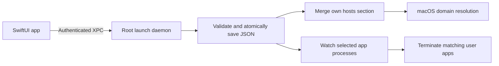

# Architecture

OneWay has two native enforcement implementations and one shared principle: a confirmed addition extends a saved set; it never replaces that set with the current picker selection.

## iPhone

`BlockList.swift` owns the generic Codable sets, limits, domain parser, catalog, and atomic persistence. `BlockModel.swift` owns individual Family Controls authorization and applies the saved list to `OneWay.Permanent`. `OneWayApp.swift` presents pickers, confirmations, and read-only saved entries.

Apple app/category/web tokens are opaque. The app does not attempt to reverse-map them into browsing or usage history. UI labels are provided by Apple's APIs. Opening or reauthorizing the app reapplies saved restrictions according to its timed-access state. The Device Activity extension restores restrictions at session expiry. See [daily access](daily-access.md).

## Mac

The UI is an ordinary user process. `SMAppService` registers a bundled launch daemon; macOS controls administrator approval and boot-time launch. The daemon runs independently of the app window. It exposes `snapshot`, `addDomains`, `addApplication`, `startSession`, and `endSession` through `NSXPCConnection`; there are no shell-command, removal, or reset methods.

Both endpoints require the expected code-signing anchor, developer team, and exact executable identifier. `prepare-build.py` generates one build identity used by both executables and their plist files. Developer configuration stays in ignored files. An ad-hoc build cannot satisfy the production Apple signing requirement.

`Core.swift` validates additions and persists data. `Enforcement.swift` merges only OneWay's hosts section, preserves surrounding content, backs up the original file before its first change, and flushes system DNS caches after changes. Host rules are checked every three seconds. Hosts rules alone do not terminate existing browser connections or implement wildcard domain filtering. Session expiry additionally closes supported browsers to terminate existing connections.

The app watcher polls about every 500 ms, examines executable paths and enclosing app bundles, and matches selected bundle IDs or original paths. It excludes protected recovery tools and non-user processes. It rechecks process identity before signaling, first using `SIGTERM`, then `SIGKILL` after a second if the process remains. This can lose unsaved application data and cannot prevent a launch from beginning.

## Data locations

| Data | Location | Authority |
| --- | --- | --- |
| iPhone list and session | App Group container, `allowance.json` | App and monitor extension, file-lock serialized |
| Mac daily budget and session | `/Library/Application Support/OneWayMac/daily-access.json` | Root daemon; mode 600 |
| Mac list | `/Library/Application Support/OneWayMac/block-list.json` | Root daemon; mode 600 in a mode-700 directory |
| Mac original hosts backup | `/Library/Application Support/OneWayMac/hosts-before-oneway` | Root daemon |
| Mac website rules | Marked section in `/private/etc/hosts` | Root daemon |
| Mac last-known UI list | App user defaults | Display cache only; never authoritative |
| Developer signing configuration | `OneWay/Signing.local.xcconfig`, `OneWayMac/.signing.json` | Developer; ignored by Git |

Validation or persistence errors stop additions. Website-enforcement errors are surfaced and retried by the service. Existing manually managed hosts rules are neither deleted nor silently imported into OneWay's permanent list.

## Testing boundaries

Automated tests exercise set union, persistence, invalid/corrupt inputs, domains/aliases, hosts merging, backups and permissions, plus termination/relaunch of a disposable fixture. They do not change the real hosts file or the real saved list.

Unsigned compilation does not exercise privileged installation. iPhone authorization, real browser behavior, restart persistence, and service approval need explicit testing on the devices being used. The Mac browser restart requirement was observed during local testing; a successful low-level connection refusal did not by itself prove that an already-running browser would stop displaying the site.
